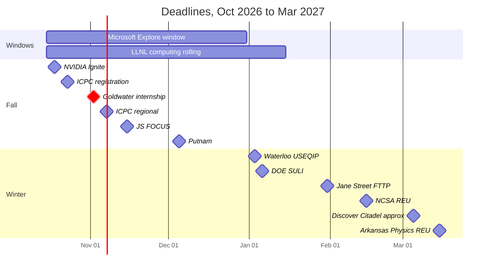

# Ahmad's 2026-27 Internship & Research Plan

Oct 15, 2026

## Next 30 days

The next three weeks matter more than the rest of the year: NVIDIA Ignite, ICPC registration, and the Goldwater internship all close before Nov 3. Do these in order.

Every program below, with deadlines and a status column, is in [[Internship Tracker]].

The action items for this live in [[To-do]] under "Claude's". Resume and ICPC are already in your Academic list there.

## How your resume reads

Your resume is strongest as a quant/competitive-programming profile and weakest as a research profile. Every program below is ranked with that in mind.

| Track | What a reviewer sees | What's missing |
| --- | --- | --- |
| Quant trading / research | USACO Gold (300+ problems), math golds (IYMC, Falcon Hunt), SAT 1560, IYPT captain. This is the classic first-year quant pattern. | Probability and expected-value practice, and a named math olympiad result (national/AMC/AIME-style) if you have one. |
| SWE (big tech, startups) | Algobility, 40+ GitHub repos, Go DSA library, USACO Guide editorials (20K+ readers). | Users, traffic or performance numbers for anything you shipped. Dates on every entry. |
| CS research (algorithms, systems) | 6.851 self-study, editorials with complexity analysis. | Any artifact showing research-style work: a benchmark, a writeup, a reproduction. "Performance optimizations" is listed as a skill with no project behind it. |
| Physics research | IYPT captain, authored solutions to three problems, trained four teams. This is real modeling-plus-experiment experience. | It's framed as leadership, not research. The boomerang work should be a project entry with method and result. |
| Quantum | Nothing on paper. | Either a small project (simulate a QRAM tree, implement a Qiskit algorithm) or leave quantum off and pitch it in emails only. |

Three things stand out as risks:

- **The EEG line overclaims.** "Leading an EEG study" with no participants reads as a study in progress. A PI who asks "how many subjects?" will downgrade everything else. Reword it as a pipeline built and validated on public data.
- **The Physics major doesn't match the profile.** That's fine at Haverford, but say in every research email why physics *and* CS. Otherwise physics faculty read you as a CS kid, and CS faculty read you as a physics major.
- **There are no dates or numbers anywhere in Experience.** Reviewers skim for duration and scale. Algobility with no user count reads as a class project.

## Deadline calendar

Goldwater (red) is the one that matters most. Full list with statuses: [[Internship Tracker]].

October and early November carry the most weight. Everything after that leans on what you built over winter break. Programs with unannounced 2027 dates (CQE OQI, Two Sigma first-year, NIST SURF, KINSC) are left off; watch for them in January.

## Industry: quant and SWE

Your realistic paid summer offers as a first-year are Microsoft Explore, NVIDIA Ignite, Two Sigma's first-year SWE internship, and the BofA freshman analyst role. The quant insight programs (Jane Street FTTP, SIG, Citadel) are short, but they're the real pipeline into sophomore and junior internships at those firms. Apply to all of them.

**Apply to these**

| Program                                                                                                                          | What it is                                                                                      | When                                                                                                                                                   | Fit for you                                                                                                                                                                                                                         |
| -------------------------------------------------------------------------------------------------------------------------------- | ----------------------------------------------------------------------------------------------- | ------------------------------------------------------------------------------------------------------------------------------------------------------ | ----------------------------------------------------------------------------------------------------------------------------------------------------------------------------------------------------------------------------------- |
| [Jane Street FTTP](https://www.janestreet.com/fttp-nyc-email.html)                                                               | 5-day trading and tech program, NYC, Mar 21 to 25, 2027                                         | Due Jan 31, 2027                                                                                                                                       | Best fit on this list. First-years in math, physics or CS, no finance needed. Your math comps and USACO are exactly what they screen for.                                                                                           |
| [SIG First-Year Discovery](https://www.quantblueprint.com/jobs/sig-first-year-discovery-event-2026)                              | Discovery event for first-years (grad 2027 to 2028 in last cycle's posting; check the 2027 one) | Fall/winter; resume submission                                                                                                                         | SIG's HQ is in Bala Cynwyd, about 15 minutes from Haverford. Proximity matters for later internships.                                                                                                                               |
| [Discover Citadel](https://www.citadel.com/careers/students/discover-citadel/)                                                   | First- and second-years, NYC                                                                    | About Mar 5, 2027 per [Extern](https://www.extern.com/post/2027-underclassmen-cs-internships-guide). Citadel's own page calls it invite-only.          | High, but invite-only means you also need Citadel's datathon/Terminal or a referral to get noticed.                                                                                                                                 |
| [Microsoft Explore](https://careers.microsoft.com/v2/global/en/exploremicrosoft)                                                 | 12-week paid SWE/PM rotation. There's a first-year application for US students.                 | Rolling windows Oct to Dec 2026                                                                                                                        | High. **Requires intro CS and one semester of calculus completed.** Calculus is covered (A-level placement plus MATH 120). Intro CS is covered too: you placed out by instructor approval. State that placement on the application. |
| [NVIDIA Ignite](https://prachub.com/resources/nvidia-ignite-internship-2027-eligibility-interview-process-and-preparation)       | 12-week internship for freshmen and sophomores; software, hardware, or business ops             | Extern reported it closes **Oct 18, 2026**. Unconfirmed, so treat it as now.                                                                           | High for the hardware/perf angle. Pitch your perf-engineering reading, but you need a project to back it up.                                                                                                                        |
| [Two Sigma First-Year SWE](https://prachub.com/resources/two-sigma-first-year-swe-internship-2027-oa-interviews-and-preparation) | Paid summer SWE internship for first-years, NYC                                                 | Last cycle opened Jan 28; be ready early Jan 2027                                                                                                      | High. Expect a hard OA; USACO Gold is good preparation.                                                                                                                                                                             |
| BofA Global Technology Freshman Summer Analyst                                                                                   | Paid tech internship, freshmen and sophomores                                                   | Sep to Nov 2026 per [FYJump](https://www.fyjump.com/post/freshman-sophomore-junior-internship-guide-for-summer-2027-150-programs-deadlines-and-how-to) | Medium. Lower prestige, but a real paid line on the resume.                                                                                                                                                                         |
| UberSTAR                                                                                                                         | Freshmen and sophomores                                                                         | Opens Sep to Oct, closes about Feb to Mar                                                                                                              | Medium.                                                                                                                                                                                                                             |
| [Bloomberg First Year Insights](https://www.bloomberg.com/company/career/first-year-insights/)                                   | Short insight program                                                                           | Spring 2027                                                                                                                                            | Medium. Cheap to apply.                                                                                                                                                                                                             |
| [Ramp](https://ramp.com/emerging-talent)                                                                                         | SWE internships, no class year stated                                                           | Rolling                                                                                                                                                | Long shot as a first-year, but Ramp hires on demonstrated building. Algobility with real users would be the pitch.                                                                                                                  |

**Only if you meet their criteria** (first-gen, financial hardship, or barriers to CS access; see open questions)

- [Jane Street JSIP](https://www.janestreet.com/join-jane-street/programs-and-events/jsip/): 2-month summer SWE program in NYC with a $12,500 scholarship. Last cycle was due Feb 8; first-year applications are reviewed in February. You likely qualify on financial need, so treat this as a real application.
- Jane Street FOCUS: Jan 11 to 14, 2027, due Nov 15, 2026. Worth applying; frame it around limited access to advanced CS before college, not just finances.
- Two Sigma College Mentor Connect, Capital One First Gen Focus, SEO Tech Developer.
- Google STEP/ASDI: no 2027 posting found as of Oct 8. Don't plan around it.

**Not open to you this year; target as a sophomore:** Explore HRT (grads 2027 to 2028), Citadel Launch, Five Rings LINK, Microsoft Explore's second-year track, JPMorgan Fellowship. Jane Street INSIGHT and HRT's winter program are for women and gender-expansive students.

**Competitions that act as recruiting pipelines** (higher leverage than most applications):

- **ICPC Mid-Atlantic Regional, Sat Nov 7, 2026, hosted at Swarthmore.** Team registration closes Oct 23 and goes through a faculty coach. If Haverford doesn't field a team, find out this week. Quant firms recruit directly from ICPC results. [ICPC MA](https://ma.na.icpc.global/)
- **Putnam, Sat Dec 5, 2026** ([date](https://carleton.ca/scs/2026/2026-putnam-mathematics-competition/)), registered through Haverford's math department. Any nonzero score helps quant applications. A top-500 score gets you noticed.
- Citadel's datathon and Terminal, and Jane Street's monthly puzzles. Low cost, and they get you on recruiter lists.

## CS research

Most CS REUs quietly prefer sophomores and juniors (DIMACS says outright that freshmen are "usually not admitted"). So your best CS research odds this summer are the new Goldwater internship, the national labs, and a faculty sponsor you've already worked with during the year.

| Program | What it is | Deadline | Fit / odds |
| --- | --- | --- | --- |
| [Goldwater Summer Research Internship](https://goldwaterinternship.gov) | New in 2027: 20 positions at universities and national labs, 10 weeks, $10,500. **Freshmen and sophomores only**, US citizens/PR, fields include CISE and Physics. | **Nov 2, 2026** | Top priority. It's built for exactly your profile, and the first year of a new program has an untested applicant pool. |
| [LLNL Computing Internships](https://computing.llnl.gov/careers/interns/faq) | Livermore computing interns; summer tracks include HPC Cluster Engineer Academy and Data Science Summer Institute | Window Sep 1, 2026 to **Jan 15, 2027**, rolling, so apply in Nov | High for perf/HPC. US citizenship is an advantage at weapons labs. Expect a 6 to 8 week hiring process. |
| [DOE SULI](https://science.osti.gov/wdts/suli) | Paid summer at 17 national labs (Argonne, Oak Ridge, Brookhaven, etc.); HPC, CS, quantum groups | **Jan 6, 2027, 5pm ET** | Medium. Name specific groups (e.g., Argonne's ALCF performance team) in your statement. |
| [NCSA FoDOMMaT REU](https://reu.ncsa.illinois.edu) (UIUC) | ML/deep-learning tooling; open to freshmen per [REU Finder](https://reufinder.com/programs-for-freshmen/) | Feb 15, 2027 | Medium. Closest freshman-open REU to systems work. |
| TACC REU (UT Austin), CMU REUSE (software engineering), Northwestern ASP REU | Freshman-open CS REUs per REU Finder | TBD for 2027, usually Feb | Medium-low. Apply as volume. |
| [Google Summer of Code](https://summerofcode.withgoogle.com) | Paid open-source contribution, any student | Apps around Mar to Apr 2027 | High if you start contributing in Jan. Pick an org touching vector search, databases, or compilers when the org list drops. |
| [MLH Fellowship](https://fellowship.mlh.io) | Stipended open-source cohorts | Rolling; spring, summer, fall | Medium. A good fallback if summer research falls through. |

**Target next year instead:** DIMACS REU (algorithms; juniors first, some sophomores), Princeton and MIT summer programs, CMU SURF (CMU students only), and Penn's SUNFEST, which has ended ([source](https://sunfest.seas.upenn.edu/)).

## Physics and quantum

Physics is where your first-year odds are best, because physics REUs take freshmen far more often than CS ones, and IYPT is a real credential to physicists. Quantum specifically needs one small project before anyone will take the interest seriously.

| Program | What it is | Deadline | Fit / odds |
| --- | --- | --- | --- |
| [Chicago Quantum Exchange OQI Fellowship](https://chicagoquantum.org/oqi-undergraduate-fellowship) | Paid quantum research at UChicago, Argonne, Fermilab, UIUC, Wisconsin, Northwestern, Ohio State, Purdue. $7,000 plus housing and travel. | 2027 not posted; last cycle closed in winter | High. Requires 4+ college STEM courses by June. Any year can apply, but rising sophomores and juniors are preferred. Your best quantum shot. |
| [Goldwater Summer Research Internship](https://goldwaterinternship.gov) | Same as CS: Physics and Astronomy is a listed field | **Nov 2, 2026** | Top priority. One application covers both tracks. |
| [DOE SULI](https://science.osti.gov/wdts/suli) | National labs, including quantum testbeds at Argonne, Fermilab (SQMS), Brookhaven, Oak Ridge | Jan 6, 2027 | Medium. |
| [NIST SURF](https://case.edu/ugstudies/students/honors-fellowships-and-awards/fellowships-and-scholarships/national-fellowships-and-scholarships/nist-summer-undergraduate-research-fellowship) | 11 weeks at NIST, $5,500 plus housing; physics labs include quantum measurement | Usually early March. **Haverford must submit for you**; ask the fellowships office now whether it participates. | Medium. Needs a 3.0+ GPA and intent to go to grad school. |
| University of Rochester Optics REU, Arkansas Physics REU, Oklahoma Physics REU, Caltech LIGO SURF | Physics/optics REUs that accept freshmen per [REU Finder](https://reufinder.com/programs-for-freshmen/) | Mostly Feb to Mar 2027 (Arkansas: Mar 15) | Medium. Rochester's quantum photonics work is the closest fit. |
| [Waterloo USEQIP](https://uwaterloo.ca/institute-for-quantum-computing/events/undergraduate-school-experimental-quantum-information-0) | 2-week experimental quantum info school, May 31 to Jun 11, 2027, free with travel bursaries | Jan 3, 2027 | Low this year. It's aimed at students a year from graduating. Apply anyway only if you've done a quantum project by then. |
| [Qiskit Global Summer School](https://www.ibm.com/quantum/blog/qiskit-summer-school-2026) | Free, virtual, 2 weeks in July | Registration around June | Not a placement, but a free certificate and a structured way to build the quantum project. |

**The quantum gap:** reading one paper on a tree-shaped quantum data structure isn't enough to put on a resume. A weekend-sized fix is to simulate bucket-brigade QRAM in Qiskit at 3 to 4 address bits, measure gate counts and noise sensitivity, and write it up. That gives you something specific to say to Gushu Li, CQE, and SULI's quantum groups.

## Year-round: Haverford, Bi-Co, Penn

Your single most likely summer research outcome is a Haverford faculty member sponsoring you for KINSC funding. Faculty want to hear from KINSC applicants before spring semester starts, and the departmental application is due the Friday spring break begins ([Physics dept page](https://www.haverford.edu/physics-and-astronomy/research/summer-research-opportunities)). So the ask goes out in November, not March.

**Haverford physics faculty who fit** (research and student notes from the department's summer research page):

| Faculty | Research | Why you | Student notes |
| --- | --- | --- | --- |
| Steve Ndengue | Molecular quantum dynamics, computational (Fortran, Python) | Quantum and performance in one lab. HPC-style numerical code is where perf engineering helps. | Sponsors interested students. No programming experience needed. |
| Ted Brzinski | Mechanics of soft/disordered matter, geophysical systems | Closest match to your IYPT experimental modeling (boomerang). | 5 to 7 students. Prefers continuing students, so get in early. |
| Karen Masters | Extragalactic astrophysics, survey and radio data | Large-data pipelines fit your signal-processing and data-structure skills. | Sponsors first-years through rising seniors for KINSC. Wants contact before spring. |
| Daniel Grin | Cosmology (axions, neutrinos, inflation), Python | Theory plus numerical work. | 3 students. Gives feedback on KINSC proposals. |
| Wynn Ho | Neutron star astrophysics | Lower fit. | Hosts only independently funded (KINSC) students. |

**Haverford CS faculty** ([faculty list](https://www.haverford.edu/computer-science/faculty-staff)). The department page doesn't list research areas, so check each profile before emailing. From what I know (approximate): David Wonnacott works on compiler loop optimization (the strongest match for Algorithmica-style perf work). Michael Wehar works in complexity and automata theory. Steven Lindell works in logic and complexity and coordinates scientific computing.

**Penn** (from our earlier list). Ask about part-time or remote work during the semester, which is an easier yes than a summer slot:

- Erik Waingarten: nearest-neighbor search algorithms. Your HNSW work is the hook.
- Ryan Marcus: learned indexes and parallel hash tables. 6.851 plus perf is the hook.
- Joe Devietti: prefetching and code-layout optimization.
- Gushu Li: quantum compilers and architecture. Wait until you have the QRAM simulation.

**Other routes during the year:**

- The Quaker Consortium lets you take a Penn course not offered at Haverford, in person. Taking a grad-level class with one of these faculty is the strongest possible way in.
- Paid campus work that reads well: CS or physics TA/grader roles, and lab assistant jobs in scientific computing.
- Swarthmore and Bryn Mawr faculty are reachable through the Tri-Co. Swarthmore is hosting ICPC this year, which is a natural reason to meet its CS faculty.

## Winter break plan and projects

Spend winter break building the one project that serves every track. You already have breadth; what you're missing is one deep artifact with numbers in it.

**Project 1 (the anchor): a performance-engineered HNSW, benchmarked.** About 3 to 4 weeks.

1. Implement HNSW from scratch in C++ (not Go, since perf reviewers expect C/C++).
2. Benchmark recall versus queries per second on the standard ann-benchmarks datasets (SIFT1M, GloVe-100) against hnswlib and FAISS.
3. Apply Algorithmica-style optimizations one at a time and measure each: SIMD distance kernels, cache-friendly graph layout, software prefetching of neighbor lists, quantized vectors.
4. Write it up as a 4 to 6 page report with plots: what each optimization bought and why, in terms of cache misses and branch behavior from `perf`.

This one artifact is the hook for Waingarten (NN search), Marcus (learned indexes and hash tables), Devietti (prefetching), NVIDIA, LLNL HPC, and every quant/SWE interview where you're asked "tell me about a project."

**Project 2: QRAM simulation.** About 1 week, in Qiskit. Bucket-brigade QRAM at 3 to 4 address bits: circuit depth, gate count, and fidelity under a noise model. This turns quantum from "read a paper" into a resume line for CQE and SULI.

**Project 3: write up the boomerang IYPT problem.** About 3 to 4 days. Model, experiment, data, and where the model failed, as a short report with figures. Physics faculty (Brzinski especially) read this as research experience.

**Running alongside, 30 to 45 minutes a day:**

- Quant prep: probability and expected-value problems (Zhou's *A Practical Guide to Quantitative Finance Interviews* is the standard), mental math drills, Jane Street's monthly puzzle. FTTP is due Jan 31.
- OA prep: timed Codeforces Div 2 rounds. USACO Gold covers the algorithms, but OAs reward speed under a clock.

**Keep, but downgrade:** the EEG pipeline. Push it to GitHub validated on a public dataset (e.g., MNE-Python sample data) so the resume line is truthful and checkable. It's no longer a target track, but it's a strong signal-processing project.

## Resume fixes

The biggest fix is structural: put Projects and Experience above Leadership and Awards, and put dates and numbers on every entry. A first-year resume gets read for about 30 seconds, and right now the first thing a reviewer sees is high school student government.

| Line | Problem | Change to |
| --- | --- | --- |
| Order of sections | Leadership comes before anything technical | Education, Experience/Research, Projects, Awards, Leadership, Skills |
| Education | Missing a Haverford GPA (once you have one) and relevant coursework | Add current courses. Once fall grades exist, add the GPA if it's 3.7+. |
| Algobility | No users, no scale, no dates | "Built and launched … used by N learners / N problems tagged / N monthly visits." Pull the numbers from analytics, even if small. |
| EEG "Leading an EEG study" | Implies participants and data that don't exist | "Built a MATLAB EEG analysis pipeline (ICA, FFT, eLORETA, connectivity, PAC), validated on public datasets, for a planned study of mood-congruent music preference." |
| Pulse Detection from Video | Good, but no result | Add accuracy versus a reference (e.g., "within X bpm of a pulse oximeter on N clips"). |
| USACO Guide | Strong; keep it | Add the number of editorials written. |
| IYPT Captain | Reads as leadership only | Keep it in Leadership, and add a Research/Projects entry for the boomerang problem: model, experiment, result. |
| USACO Gold | Fine for SWE, but for quant firms the important number is contest rank | Add a Codeforces rating once you have a stable one. |
| Bebras, Falcon Hunt, IYMC | Unfamiliar names to US reviewers | Add the scale ("1st of 800+" is good; do the same for each). Cut the "12 trophies" line, which reads as filler. |
| Akhuwat internship | Unrelated to the tracks | Shrink it to one line, or keep it only for applications that value service. |
| PANIM, Pseudocofidy, Go DSAlib | No users or scale | Keep one or two with a concrete number. Replace the rest with the HNSW project once it's done. |
| Skills: "Performance optimizations" | Unsupported claim | Remove it until the HNSW project exists, then point to it. |
| "40+ additional projects" | Quantity signals nothing | Cut it. GitHub is in the header. |
| Whole resume | No dates anywhere | Month/year ranges on every entry. |

Keep it to one page. Make a separate quant version that leads with math awards and competitive programming, and a research version that leads with projects and the boomerang and EEG work.

## Open questions

Each answer changes what's on the list. Reply with comments here.

- [ ] **Coursework:** Have you finished (or will you finish this semester) intro CS and a semester of calculus at Haverford? Microsoft Explore requires both. Do your A Levels give you placement credit?

- [ ] **Barrier-based programs:** Do you meet any of the criteria for JSIP, FOCUS, or the first-gen programs (first-generation college student, financial hardship, limited CS access before college)? That would add 4 to 6 strong options. Answer only if you're comfortable.
- [ ] **Physics vs CS:** Is "intended Physics major" firm, or might you switch to CS or double? It changes which faculty you should be cultivating this semester.
- [ ] **ICPC:** Does Haverford field an ICPC team, and do you want in? The regional registration deadline is Oct 23.
- [ ] **Summer constraints:** Is pay mandatory? Can you relocate anywhere in the US for 10 weeks? Any travel back to Lahore that blocks dates?
- [ ] **Algobility numbers:** Do you have any user or traffic data at all?
- [ ] **Math competitions:** Any national olympiad result (Pakistan MO, etc.) not on the resume? It matters a lot for quant.
